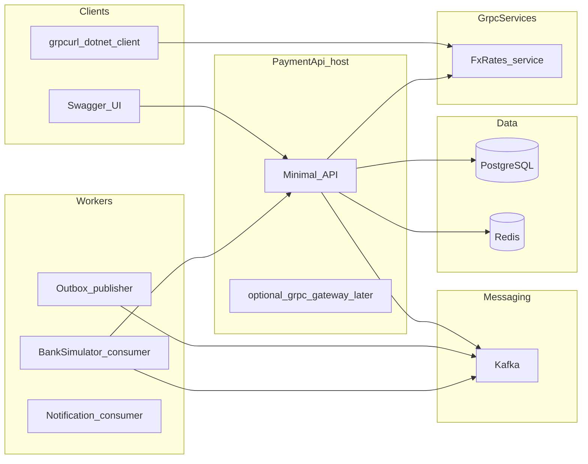
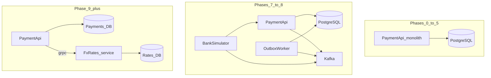
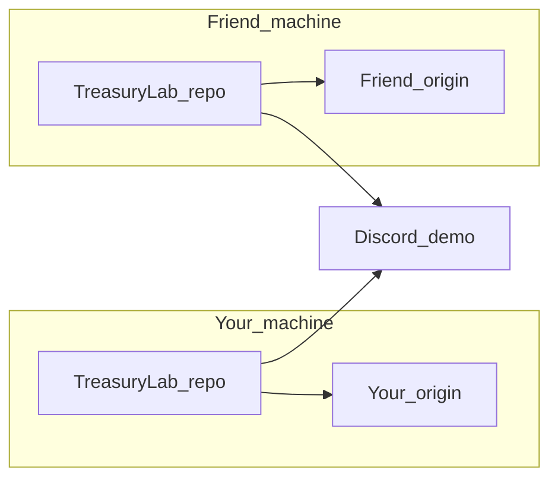

# TreasuryLab — план учебного проекта

## Оценка текущего [TreasuryLab](c:\Users\pjank\source\repos\TreasuryLab)

**Уже хорошо для старта**

| Что | Зачем |
|-----|--------|
| `net10.0`, `Nullable`, `ImplicitUsings` | Совпадает с [finaxio backend](c:\Users\pjank\source\repos\finaxio\backend\src\CashBalance\CashBalance.csproj) |
| `DockerDefaultTargetOS: Linux`, [Dockerfile](c:\Users\pjank\source\repos\TreasuryLab\TreasuryLab\Dockerfile), профиль *Container* в [launchSettings.json](c:\Users\pjank\source\repos\TreasuryLab\TreasuryLab\Properties\launchSettings.json) | База для Docker-фаз |
| Минимальный [Program.cs](c:\Users\pjank\source\repos\TreasuryLab\TreasuryLab\Program.cs) | Чистый холст без лишней магии |

**Чего пока нет (и это нормально — добавим по фазам, не всё сразу)**

- Многослойное solution (у finaxio: Domain → DomainServices → ApplicationServices → Infrastructure → host)
- Тестовый проект, `Directory.Build.props`, editorconfig
- `docker-compose` для Postgres / Redis / Kafka (у finaxio: [deployments/standalone/docker-compose.yaml](c:\Users\pjank\source\repos\finaxio\deployments\standalone\docker-compose.yaml), Helm в [deployments/helm](c:\Users\pjank\source\repos\finaxio\deployments\helm))
- OpenAPI/Swagger, health checks, structured logging
- Отдельные сервисы под gRPC и consumers

**Небольшие замечания (не блокеры)**

- Один проект в [TreasuryLab.slnx](c:\Users\pjank\source\repos\TreasuryLab\TreasuryLab.slnx) — на фазе 2–3 разнесём на классическую структуру папок `src/` и `tests/`
- В Dockerfile два порта `8080/8081` под HTTPS — для учебного Swagger-API можно упростить до HTTP-only в dev, TLS добавить в фазе K8s/Ingress
- Пакет `Microsoft.VisualStudio.Azure.Containers.Tools.Targets` — только для VS; на CI не обязателен

**Итог:** пустой web-шаблон с Docker — **подходящая** точка входа. Следующий осмысленный шаг — не «ещё пакеты», а **предметная область + доменный класс-библиотека без БД**.

---

## Идея продукта (по мотивам finaxio, но в 10× меньше)

**TreasuryLab** — внутренний сервис заявок на исходящий платёж:

- Счета юрлица, лимиты, валюты
- Заявка: сумма, получатель, назначение, статус (черновик → на согласовании → в банк → исполнен / отклонён)
- События для других систем: «заявка одобрена», «статус от банка»
- Позже — отдельный **FxRates** (gRPC) и **BankConnector** (имитация банка через Kafka)

Разработка **параллельно**: **один и тот же** план и чеклист фазы, но **два независимых git-репозитория** (два `origin`, две истории коммитов). Стыковка смысла и проверки — **Discord** (демо), не `git pull` друг у друга. Сколько **процессов в рантайме** — «Микросервисы или нет?»; организация — «Локально + Discord».

---

## Микросервисы или нет?

Краткий ответ: **не с первого дня**. Архитектура намеренно **растёт**, как в реальных командах (сначала монолит, потом выделение границ).

| Этап (фазы) | Что в рантайме | Как называть честно |
|-------------|----------------|---------------------|
| **0–5** | Один процесс: `TreasuryLab.Api` (+ Postgres, Redis в compose) | **Модульный монолит**: много проектов в solution, **один** deployable, одна БД |
| **6–8** | `api` + `outbox-worker` + `bank-simulator` (+ Kafka) | **Распределённая система**; при выносе — **отдельный git-репозиторий на сервис у каждого** (у тебя свой BankSimulator, у друга свой). Shared DB — учебное упрощение, в `SENIOR.md` |
| **9+** | Отдельный **`FxRates`** (gRPC, свой процесс и своё хранилище курсов) + Payment API + workers | **Микросервисы в учебном минимуме**: независимый деплой, контракт через Protobuf, отдельная ответственность за данные |

Связь с **finaxio**: там в проде чаще **один основной backend-контейнер** и тяжёлый модульный monolith в solution; Redis/Kafka-паттерны вы тренируете **шире**, чем в текущем finaxio (gRPC там не в фокусе).

Практическое правило для вас двоих:

- Пока вся логика заявок в одном API и одной схеме Postgres — говорите **«монолит»**, не «микросервисы».
- Когда появится **второй deployable с своей БД и gRPC-контрактом** — можно честно говорить «микросервисная архитектура (учебная)».

---

## Ловушки на каждой фазе (терминология)

Имеется в виду **не** «замкнуть тему», а типичные **ошибки в C# / async / распределёнке**:

1. **Closure-ловушка** — захват переменной цикла в лямбде/`Task`/`Task.Run`/`Select`: перебрали `{1,2,3}`, в делегатах везде оказалось **3** (или последнее значение). Лечение: локальная копия, `for` с индексом, `Parallel.ForEach` с правильной сигнатурой, понимание замыкания над полем vs over loop variable.
2. **Гонка (race)** — два потока/запроса без синхронизации или без версии строки; результат зависит от порядка.
3. **Распределённый кейс** — дубликат сообщения, потеря порядка, at-least-once, split brain воркеров (уже не про closure, но рядом на собеседованиях).

На каждой фазе: **цель → что трогать → подсказки (без кода, пока не попросите) → 1–2 ловушки из списка выше → критерий «фаза сдана»**.

Журнал прогресса: у **каждого** свой `docs/LEARNING.md` в **своём** git; на созвоне сверяете ответы на ловушки (можно скидывать друг другу файл в Discord без общего repo).

---

## Локально + Discord (как вы реально работаете)

**Параллельно** = одна фаза, **один чеклист**, **два ПК**, **два git repo**; **не** разделение «ты — API, друг — только домен».

| Что | Как |
|-----|-----|
| **Одинаковая работа** | Обе стороны делают те же шаги фазы в **полном** solution |
| **Синхронизация** | Discord: демо экрана, разбор ошибок, closure-ловушка |
| **Git** | **Разные репозитории:** у тебя свой `origin`, у друга свой; общего GitHub/org **нет** |
| **План и docs** | Чеклист фазы один; `JUNIOR.md` ведёшь ты и **передаёшь** другу (файл, gist, ветка-архив) — он кладёт в **свой** repo |
| **Контракты (позже)** | Эталон `.proto`/JSON-схемы — версия `contracts-0.1.0` (zip или отдельный маленький repo у тебя); друг **импортирует** к себе, не обязан `git clone` твой Payments |
| **Темп** | Друг на 1–2 дня позже — ок, если критерий «сдано» тот же |

| Что за repo (логика) | У тебя | У друга | Фаза |
|----------------------|--------|---------|------|
| **TreasuryLab** (основной) | свой git; старт [TreasuryLab](c:\Users\pjank\source\repos\TreasuryLab) | свой git; тот же скелет папок по чеклисту | 0–5 |
| **TreasuryLab.Contracts** | свой git | свой git; proto копируется с **версии**, которую вы зафиксировали на созвоне | 7+ |
| **TreasuryLab.FxRates** | свой git | свой git | 9+ |
| **TreasuryLab.BankSimulator** | свой git | свой git | 7–8 |

**Дрейф кода между вами — нормален:** на созвоне сравниваете поведение (тесты, Swagger), не обязательно одинаковый diff. Расхождение — повод для разбора.

### Ритуал созвона

1. **До:** оба — `dotnet test` и сценарий проверки из фазы; ты готовишь устно блок «Зачем» из `JUNIOR.md`.
2. **На созвоне:** друг демо → твой демо → одна ловушка («что вывело? почему?»).
3. **После:** каждый `git push` **в свой** origin; ответ на ловушку в своём `LEARNING.md`; ты дополняешь `SENIOR.md` у себя и обновляешь `JUNIOR` для следующей передачи другу.

### Когда больше одного git-репозитория на человека

Два уровня:

1. **Всегда:** у тебя и у друга **разные** git на один и тот же учебный проект (две истории).
2. **С фазы 7–9:** плюс **отдельный git на сервис** (Contracts, FxRates, BankSimulator) — снова **по две копии в мире** (твоя + друга), стыковка по версии контракта и демо в Discord.

Фазы 0–5: у каждого **один** repo TreasuryLab. Monorepo внутри машины (несколько проектов в solution) — можно; несколько **git** на диске — по мере выноса сервисов.

### Глубина при одинаковых задачах

| | Друг | Ты |
|---|------|-----|
| Код | тот же scope | тот же scope |
| Понимание | база после JUNIOR + демо | база + `SENIOR.md` |
| Созвон | показывает, спрашивает | объясняешь; Senior — по желанию |

Сложная тема (Kafka, outbox): **оба** поднимают compose и пишут тот же worker/consumer; ты готовишь **10-минутное** объяснение в `JUNIOR.md` **до** созвона.

---

## Два слоя пояснений: Junior (для друга) и Senior (для тебя)

В **твоём** репозитории — полный набор `docs/JUNIOR.md` + `docs/SENIOR.md`; в **репо друга** — минимум `JUNIOR` (копия с версии фазы) + свой `LEARNING.md`. `SENIOR` другу не обязателен.

### `docs/JUNIOR.md` — то, что **ты зачитываешь/пересказываешь** другу

Формат на каждую фазу (шаблон, не код):

- **Зачем нам это** (1 абзац бытовой аналогии: заявка = заказ, outbox = блокнот кассира)
- **Что сделать руками** (3–7 буллетов, один PR/коммит)
- **Словарик** (5 терминов: «миграция», «идемпотентность», …)
- **Проверка** («если в Swagger видишь X — ок»)
- **Ловушка недели** (одна closure или одна гонка — **что вывело программа**)

Язык: без акронимов без расшифровки; Kafka = «журнал событий, куда сервисы подписываются».

### `docs/SENIOR.md` — **только тебе** (глубина под собес и прод)

На ту же фазу:

- **Trade-offs** (почему не X)
- **Связь с finaxio** (что похоже на outbox multibank, что у вас проще)
- **Failure modes** (at-least-once, split brain, poison message)
- **Что спросят на Senior** (2–3 вопроса + короткие тезисы ответов)
- **Ссылки** (MS Learn, блоги Confluent, gRPC style guide)

### Шпаргалка: что сказать на Discord (ты → друг)

| Тема | Оба делают руками | Ты говоришь (JUNIOR) | Ты читаешь сам (SENIOR) |
|------|-------------------|----------------------|-------------------------|
| Docker Compose | `docker compose up`, Swagger открывается | контейнер, volume, порт | health, secrets, multi-stage |
| Kafka | producer + consumer в **своих** репозиториях | топик, ключ партиции, «журнал» | offsets, consumer group, at-least-once |
| Outbox | worker + таблица outbox у **обоих** | блокнот в БД → курьер в Kafka | SKIP LOCKED, vs 2PC |
| gRPC | grpcurl / вызов из API у **обоих** | «внутренний быстрый вызов» | proto versioning, deadlines |

---

## Фаза 0 — Договорённости: два git repo, один чеклист, Discord

**Уровень:** Junior (друг: `git init`, build) + Middle (ты: структура solution, эталон скелета)

**Сделать (оба, в своих репозиториях)**

- **Ты:** оформляешь [TreasuryLab](c:\Users\pjank\source\repos\TreasuryLab) → TreasuryLab, свой `origin`
- **Друг:** новый repo (`git init`) + тот же **скелет папок/проектов**, что в чеклисте (не `git clone` твоего origin)
- `docs/JUNIOR.md`, `docs/SENIOR.md` (у друга — только JUNIOR после передачи), `LEARNING.md` у каждого локально
- Договориться: как передаёшь обновления JUNIOR между фазами (файл в Discord, gist, тег `docs-phase-N` у тебя)
- Зафиксировать **день/время** созвона и формат демо
- В `JUNIOR.md` фазы 0: «solution, project, reference, зачем два repo» — текст для первого созвона

**Ловушки**

- **Junior (не closure):** лишний `using` / ссылка на ASP.NET в Domain — почему class library не должна тянуть host?
- **Closure (разогрев):** в консольном `Main` или факте в тесте собрать `List<Task>`, в `foreach` по `new[] { 1, 2, 3 }` вызвать `Task.Run(() => Console.WriteLine(i))` — записать фактический вывод; объяснить другу **без подглядывания в интернет**, затем сверить с [foreach и capture в C#](https://learn.microsoft.com/dotnet/csharp/language-reference/statements/iteration-statements#the-foreach-statement)

**Сдано, когда:** solution собирается; Domain — class library без веб-зависимостей; в `LEARNING.md` — абзац «что вывел цикл и почему».

---

## Фаза 1 — Доменная модель и типы C#

**Уровень:** Junior (основной) + Middle (инварианты, value objects)

**Темы для друга:** reference vs value, `decimal` для денег, `readonly struct` / `record`, `enum` vs smart enum, nullability, `Money` + валюта (ISO 4217).

**Сущности (черновик языка):**

- `PaymentRequestId`, `AccountId`, `Money`, `PaymentRequest` (агрегат), `PaymentStatus`, `ApprovalStep` (опционально)
- Read-only DTO наружу домена позже — сейчас **иммутабельные** типы в Domain

**Подсказки:** посмотреть в finaxio паттерн `ReadOnly*` в domain services; у вас проще — records в Domain.

**Ловушки**

1. **Домен:** сложили `100 USD + 100 EUR` — что должно случиться?
2. **Домен:** два `PaymentRequest` с одинаковыми полями, разные `Id` — равны ли по `Equals` / `==`?
3. **Closure:** генерируете набор `Func<PaymentStatus>` или задач в `foreach` по допустимым переходам; делегаты вызывают «текущий» статус из объявления **вне** цикла, который мутируется в конце — тесты «все зелёные» проходят один и тот же переход. Исправить копированием в локальную переменную / factory-методом.
4. **Гонка (задел):** обсудить вслух, почему мутабельный `PaymentRequest` + параллельные тесты — плохая идея (к фазе 2).

**Сдано, когда:** unit-тесты на переходы статусов без БД и API; отдельный тест демонстрирует closure **до** и **после** фикса.

---

## Фаза 2 — HTTP API + Swagger (in-memory)

**Уровень:** Junior → Middle

**Сделать**

- Host-проект остаётся entrypoint; Application — тонкий слой «use cases»; репозиторий **in-memory** (Dictionary + lock — намеренно наивно)
- Minimal API или controllers — на ваш вкус; **Swagger с первого дня** (ваш выбор UI)
- Версионирование API: `/api/v1/payment-requests`

**Ловушки**

1. **Closure (Middle):** нагрузочный тест/утилита: `foreach (var id in requestIds)` добавляет `Task.Run(() => client.ApproveAsync(id))` без локальной копии `id` — все запросы бьют в **последний** id; починить и убедиться по логам/Swagger.
2. **Гонка:** два параллельных `POST` создают заявки — in-memory repo без синхронизации: воспроизвести и исправить (`lock`, `ConcurrentDictionary`, или один writer).
3. **Lost update:** два `PATCH` «одобрить» на одну заявку — кто победил и почему без optimistic concurrency.

**Сдано, когда:** сценарий из Swagger: создать → на согласование → approve; тест на closure + тест на гонку зелёные.

---

## Фаза 3 — PostgreSQL + EF Core (или Dapper — одно выбрать и не метаться)

**Уровень:** Junior (миграции, CRUD) + Middle (транзакции, concurrency token)

**Сделать**

- Проект `TreasuryLab.Database` по аналогии с finaxio
- Миграции, seed одного тестового юрлица и счетов
- Заменить in-memory repo на реальный; **row version** / `xmin` для optimistic concurrency

**Ловушки**

1. **Гонка:** двойной клик «Создать заявку» с одним idempotency-key — в БД одна строка (unique index + обработка конфликта).
2. **Распределённый задел:** транзакция: лимит + смена статуса — откат посередине; что видит второй запрос?
3. **Closure (optional):** батч-утилита: в цикле по id открываете `DbContext` в `Task.Run` без copy id / без await в правильном scope — «обновилась одна заявка N раз». Разобрать scoped lifetime vs capture.

**Сдано, когда:** Postgres локально или в compose; идемпотентность и concurrency token работают; **архитектура всё ещё монолит** (один API, одна БД).

---

## Фаза 4 — Слои как в finaxio (упрощённо)

**Уровень:** Middle

**Целевая схема проектов** (не копировать 20 проектов finaxio):

| Проект | Роль |
|--------|------|
| `TreasuryLab.Domain` | модель, инварианты |
| `TreasuryLab.Application` | команды/запросы, порты (interfaces) |
| `TreasuryLab.Infrastructure` | EF, Redis, Kafka adapters |
| `TreasuryLab.Api` | host, Swagger, DI composition |

**Ловушки**

- **Архитектура (не closure):** нарисовать граф ссылок между проектами; Domain не тянет Infrastructure (опционально NetArchTest).
- **Closure:** регистрация в DI в цикле — `foreach (var handler in handlers) services.AddSingleton<IHandler>(sp => handlerThatCapturesLoopVar)` — все resolve’ятся на один handler; поймать в тесте или при старте.

**Сдано, когда:** фича «отклонить с причиной» в Application + Domain; по-прежнему **один** deployable API.

---

## Фаза 5 — Docker Compose (уверенный Docker)

**Уровень:** Middle → Senior (networking, health)

**Сервисы dev-compose** (по духу finaxio, но проще):

- `api`, `postgres`, `redis`, позже слот под `kafka` + `zookeeper`/`kraft`
- healthchecks, `depends_on` с condition, переменные как у finaxio (`CB_*` стиль — `TL_*`)
- multi-stage Dockerfile только для `Api`; отдельные Dockerfile для workers — когда появятся

**Ловушки**

1. **Инфра:** API стартует раньше Postgres — починить retry/health, не `sleep 30`.
2. **Инфра:** connection string в образе vs env в compose — что нельзя `COPY` в image.
3. **Closure (слабая связь):** скрипт/тест поднимает несколько контейнеров в `foreach` и в callback сохраняет «последний» порт в список — smoke-test стучится не туда (если пишете automation на C#).

**Сдано, когда:** `docker compose up` → Swagger; всё ещё **один** backend-контейнер для домена заявок.

---

## Фаза 6 — Redis: кэш, лимиты, идемпотентность

**Уровень:** Middle

**Кейсы**

- Кэш справочника валют / счетов (TTL)
- Идемпотентность HTTP через Redis SET NX
- Distributed lock **только для учебного сценария** (Redlock не обязателен) — обсудить, почему lock ≠ транзакция в БД

**Ловушки**

1. **Гонка:** cache stampede после TTL — 100 одновременных запросов в БД; обсудить single-flight / lock в Redis.
2. **Распределённый:** idempotency-key через 25 часов — новая заявка или та же?
3. **Closure:** `foreach` по ключам кэша запускает `Task.Run` для прогрева — без копии ключа инвалидируется один ключ; логи показывают паттерн «все Task с одним key».

**Сдано, когда:** cache hit в логах; по архитектуре — **монолит + Redis**, не новый микросервис.

---

## Фаза 7 — Kafka: события и контракты

**Уровень:** Senior (основной), Middle помогает с сериализацией и тестами

**Темы**

- Topic design: `payment.request.v1`, `payment.status.v1`
- Producer из API; consumer **BankSimulator** меняет статус через задержку
- Schema: начать с JSON + соглашение; позже — **Protobuf** в Schema Registry (или файл `.proto` в репо для простоты)
- Semantics: at-least-once, дубликаты, порядок по ключу (`payment_request_id`)

**Ловушки**

1. **Распределённый:** consumer упал после обработки, до commit offset — дубликат; идемпотентный handler.
2. **Распределённый:** два partition — нарушен порядок по одной заявке; message key обязателен.
3. **Распределённый:** poison message → DLQ topic.
4. **Closure:** в consumer’е `foreach (var msg in batch)` стартуете fire-and-forget `Task` без захвата **копии** payload/offset — обрабатывается последнее сообщение N раз.

**RabbitMQ (точечно):** очередь разовых задач (email/PDF) — routing и TTL; сравнение с Kafka в `LEARNING.md`.

**Сдано, когда:** Swagger → Kafka → **отдельный процесс** `bank-simulator` → статус в API. Это уже **несколько сервисов**, но БД заявок пока **одна** — честно назвать «multi-process monolith» или «распределённый монолит».

---

## Фаза 8 — Outbox + фоновый publisher

**Уровень:** Senior (прямая отсылка к опыту finaxio outbox в multibank)

**Идея**

- В одной транзакции БД: изменение заявки + строка `outbox_events`
- Worker читает outbox и публикует в Kafka (polling или logical replication — для учебы polling достаточно)

**Ловушки**

1. **Распределённый:** outbox закоммичен, worker отстаёт — 200 OK, события ещё нет 30 с — eventual consistency.
2. **Гонка:** два инстанса worker — двойная публикация; `FOR UPDATE SKIP LOCKED` / claim.
3. **Распределённый:** Redis read model отстаёт от outbox.
4. **Closure:** polling loop создаёт `Task` на каждую строку outbox в `foreach` и общий `List<Exception>` мутируется из всех task без синхронизации — «странные» aggregate errors.

**Сдано, когда:** Kafka offline → outbox копится → после подъёма догон. **+1 deployable** (`outbox-worker`), shared DB допустима для учёбы.

---

## Фаза 9 — gRPC + Protobuf

**Уровень:** Senior

**Сервис `FxRates`**

- `.proto`: `GetRate`, `ConvertMoney`
- Клиент из `PaymentApi` при создании заявки в «неродной» валюте
- REST наружу, gRPC **между сервисами** (как на собеседовании)

**Ловушки**

1. **Контракт:** новое поле в proto — backward compatibility; что ломает старых клиентов.
2. **Гонка / async:** deadline/cancellation gRPC — тормозит FxRates, клиент отменил — освобождены ли ресурсы?
3. **Closure:** параллельно конвертируете несколько сумм: `foreach` + `Task.Run(() => client.Convert(..., rateCapturedFromLoop))` — все конвертации с **последним** rate.
4. **Архитектура:** записка gRPC vs REST — когда что; **FxRates со своей БД** — первый настоящий **микросервис** в проекте.

**Сдано, когда:** compose поднимает Payment API + FxRates; grpcurl smoke-test; **две** независимые data stores для разных bounded contexts.

---

## Фаза 10 — WebSocket (опционально, ваш сильный бэкграунд)

**Уровень:** Middle recap

Если останется энергия до Razor: **SignalR hub** «статус заявки» для Swagger-наблюдателя или простой HTML-страницы на static files — **без полноценного Razor до конца**.

**Ловушки**

- **Распределённый:** reconnect SignalR / WebSocket — `Last-Event-Id`, догнать пропущенные из `payment_events` или compacted topic.
- **Closure:** на подписке в цикле по connectionId вешаете callback, захватывающий **последний** id hub’а — не тот клиент получает push (если пишете fan-out вручную).

---

## Фаза 11 — Kubernetes + Helm (упрощённый finaxio)

**Уровень:** Senior

**Минимум как в** [deployments/helm/cash-balance](c:\Users\pjank\source\repos\finaxio\deployments\helm\cash-balance):

- Deployment api + workers, Service, ConfigMap/Secret, Ingress (локально: k3d/kind + nginx)
- Liveness vs readiness; probes на `/health/ready` (проверяет Postgres, не Kafka — обсудить почему)
- HPA — опционально, только после метрик

**Ловушки**

1. **Распределённый:** rolling update — старый и новый proto в кластере одновременно.
2. **Инфра:** rotation Secret — порядок изменений.
3. **Распределённый:** pod killed mid-outbox — at-least-once снова.
4. **Гонка:** два реплики API без sticky session — не путать с closure; отдельно обсудить.

**Сдано, когда:** helm install; port-forward → Swagger; в кластере **несколько Deployment’ов** (api, workers, fx-rates) — картина **микросервисов в K8s**.

---

## Фаза 12 — Наблюдаемость и «прод-привычки»

**Уровень:** Senior

- Structured logging (Serilog как в finaxio host)
- OpenTelemetry: trace от HTTP → DB → Kafka → gRPC
- Correlation id сквозь заголовки и сообщения

**Ловушки**

- **Распределённый:** один trace через HTTP → DB → Kafka → gRPC; найти в логах.
- **Closure (диагностика):** `ActivitySource` / enricher в цикле по ключам логирования вешает delegate, который всегда пишет **последний** paymentId в scope — в trace «все span’ы про одну заявку».

---

## Фаза 13 (конец) — Razor / UI

**Уровень:** Junior UI + ваш Razor-опыт

Тонкий Razor Pages: список заявок, форма создания, live-статус (SignalR). Не SPA — сознательно мало, чтобы не размыть backend-фокус.

---

## Рекомендуемый порядок старта (согласован с вашей идеей)

1. **Фаза 0–1** — domain + тесты + первая **closure-ловушка** в цикле/`Task` (лучший старт для друга)
2. **Фаза 2** — Swagger, чтобы друг видел «живой» backend
3. Дальше строго по таблице; **Kafka (7–8)** только после уверенного **Postgres + Compose (3–5)**

Код не пишем в чате, пока не попросите; на каждой фазе можно запросить «подсказку следующего шага» или «чеклист файлов».

---

## Отличия от finaxio (намеренно)

| finaxio | TreasuryLab |
|---------|-------------|
| Много integration-модулей | Один BankSimulator |
| Redis, Postgres, Helm | То же, но меньше сервисов |
| Нет gRPC в явном виде | gRPC — учебный фокус |
| Outbox в multibank | Outbox в core flow |
| Большой frontend | Swagger до фазы 13 |

---

## Риски и как не выгореть

- Не подключать Kafka до работающего outbox-less producer в тестах — иначе сложность съедает Junior-трек
- Не раздувать Domain Services как в finaxio до фазы 4
- Каждые 2 фазы — «релиз»: у **каждого** свой тег `phase-N` в **своём** git + демо в Discord

